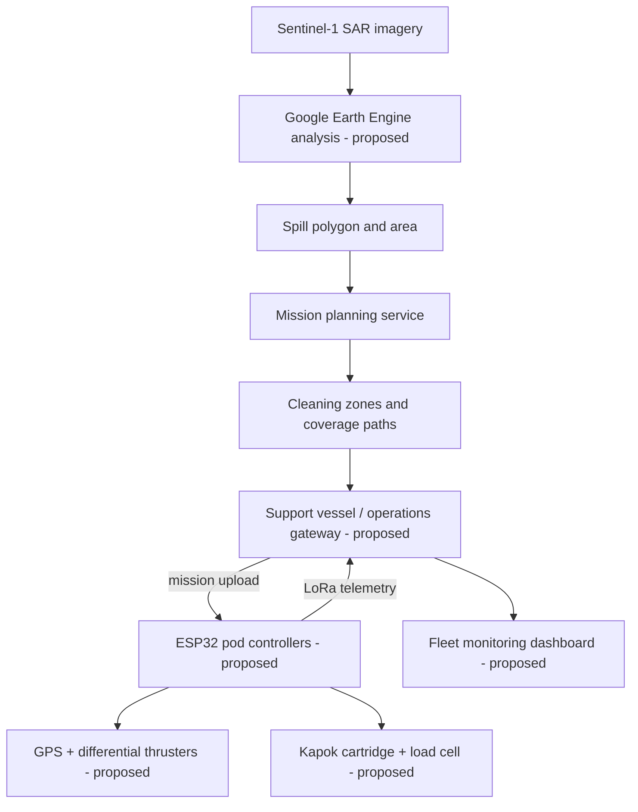
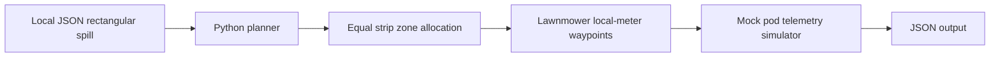
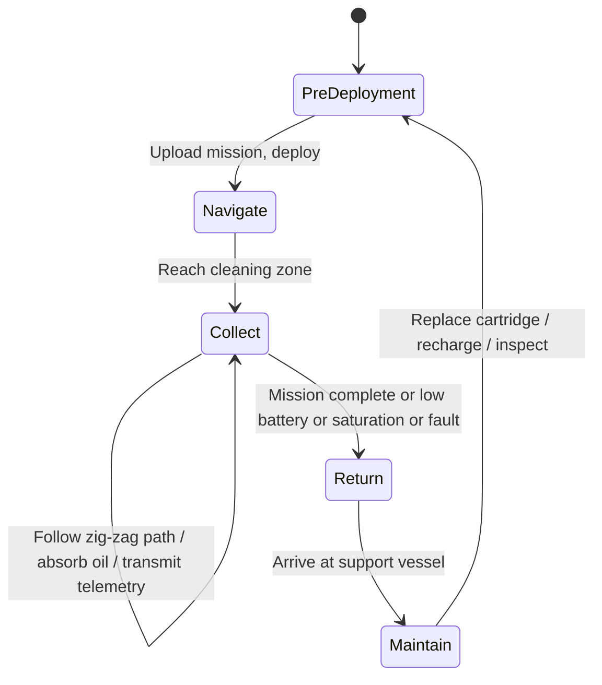

# Technical Design Document

**Status:** Proposed full system; only the offline rectangular-zone planner and telemetry simulator in this repo are implemented.

## Objective
EcoSorb Pods proposes to detect and map marine oil spills; estimate resources; generate non-overlapping cleanup assignments; coordinate multiple floating, kapok-fiber collection pods; and recover/redeploy pods via a support vessel.

## Intended high-level architecture

## Implemented demonstration architecture

## Key modules
| Module | Proposal in handbook | Status in this repository |
|---|---|---|
| Oil detection | Sentinel-1 SAR + GEE spill segmentation | **Not implemented** |
| Geometry | Spill polygon and area | Demo rectangular local-meter shape only |
| Mission planner | Capacity estimation, zone allocation, GPS waypoint routing | Basic estimated mass and cartridge loads; strip zones; **not GPS** |
| Pod electronics | ESP32; GPS; sensors; ESC-driven brushless thrusters | **Not implemented** |
| Communications | LoRa to support vessel | **Not implemented** |
| Fleet monitoring | Position, battery, cartridge saturation, faults | Offline synthetic telemetry only |
| Cleanup | Semi-catamaran hull guides floating oil into replaceable kapok cartridge | **Not implemented or tested** |

## Data flow and formulas
1. Intended: Sentinel-1 is processed by GEE to estimate a spill polygon; **radar darkness alone does not confirm oil**, so validation and look-alike filtering are required.
2. Implemented demo: sample rectangle uses meters; area = width × height.
3. Rough estimate: `oil_mass_kg = area_m2 × assumed_thickness_m × assumed_density_kg_m3`.
4. Cartridge equivalents = `ceil(oil_mass_kg / assumed_capacity_kg)`; should not be confused with number of simultaneously active pods.
5. Zones: split rectangle into equal x-direction strips for `available_pods` (no bathymetry, currents, collision prediction, or geographic transforms).
6. Each strip receives a zig-zag list of local-meter route points. A mock simulator estimates battery and collected oil per reached point.

## Full proposed pod operation

## Safety requirements before real operations
Hard geofencing; manual remote stop; watertight/leak monitoring; guarded propellers; communications watchdog; degraded-GPS behavior; collision avoidance; return-energy budget; human oversight; environmental permitting; hardware-in-the-loop tests; measured kapok performance; field trials.

## Technology choices from handbook
Sentinel-1 SAR, Google Earth Engine, GPS, ESP32, LoRa, two brushless thrusters/ESCs, battery monitor, load cell, local oil-presence sensor, semi-catamaran hull, biodegradable kapok cartridge. **These are design choices, not verified hardware integrations.**
